# Decisiones de diseño

API para guardar movimientos editables, buscar sus IDs por tipo y sumar una transacción con sus descendientes. Este documento explica el comportamiento acordado sin depender del código.

[Enunciado completo](assigment.md) · [Ejecución y limitaciones](../README.md)

## Alcance

| Tema | Decisión |
| --- | --- |
| Plataforma | Spring Boot 4.1.2 y Java 27, sin SQL. Versiones de herramientas en el README. |
| Entrega | Aplicación dockerizada, tests de integración y repositorio GitHub o Bitbucket. |
| Extensión | Paginación opcional en la búsqueda por tipo. |
| Fuera de alcance | Versioning, autenticación, rate limiting, interfaz visual, borrado e historial de cambios. |
| Capacidad | Sin límites de negocio adicionales para cantidad o profundidad. Tipo: máximo técnico de 1024 bytes UTF-8 normalizados. La memoria disponible limita la capacidad. |

La entrega prioriza el contrato y las reglas del challenge. La paginación agrega utilidad y pruebas; autenticación, persistencia y operación con varias instancias quedan para una evolución de producción.

Usar dependencias mínimas, con una función actual y sin duplicar herramientas. Elegir las últimas versiones estables compatibles entre sí y fijarlas para reproducibilidad. Avisar si una dependencia no aporta valor o requiere una excepción de versión. [Política de dependencias](tests.md#política-de-dependencias).

## Modelo y relaciones

Interpretamos «transacción» como un registro de movimiento editable con monto y categoría. El enunciado no define un libro contable, una transferencia entre cuentas ni un historial auditable. Tampoco usamos aquí el término para describir una transacción de base de datos.

| Tema | Decisión |
| --- | --- |
| Transacción | Registro de movimiento editable; no un asiento contable definitivo. |
| Datos | ID, monto, tipo y padre opcional. |
| Jerarquía | Cada transacción tiene hasta un padre y puede tener varios hijos. |
| Padre | Debe existir antes de guardar al hijo. |
| Ciclos | Rechazar ciclos y autorreferencias: contradicen la jerarquía. |

Las flechas van del padre al hijo. La jerarquía no implica usar un árbol de búsqueda como almacenamiento.

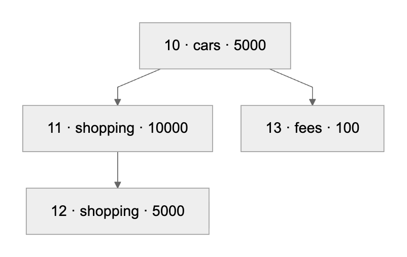

`sum(10) = 20100` y `sum(11) = 15000`. No se incluyen padres ni hermanos.

Exigir un padre existente simplifica las consultas, pero obliga a cargar padres antes que hijos. Prohibimos ciclos por su significado de negocio; al cambiar un padre hay que comprobar los antecesores del padre propuesto para no cerrar uno.

Un ID nuevo solo necesita comprobar autorreferencia y existencia del padre: todavía no puede pertenecer a sus antecesores. Un reemplazo que conserva el padre tampoco cambia la jerarquía. Recorremos antecesores únicamente al cambiar el padre de un ID existente. Esto evita validaciones cuadráticas al crear cadenas; mantener los IDs ordenados por tipo sigue costando O(log n) por inserción. Todo ocurre bajo el mismo lock de escritura.

Estas son interpretaciones del ejercicio, no reglas universales del dominio financiero. Con más contexto podríamos exigir movimientos definitivos, correcciones mediante nuevos registros o auditoría, en lugar de permitir reemplazos. Del mismo modo, la jerarquía tendría que validarse contra el significado real de la relación.

## Datos de entrada

| Campo | Regla |
| --- | --- |
| ID y padre | Enteros de todo el rango de `long`, incluidos cero y negativos. Sin truncamiento. |
| Monto | `double` finito, obligatorio. Admite positivos, cero y negativos. |
| Tipo | Obligatorio. Quitar espacios externos y convertir a minúsculas al guardar y consultar. Máximo: 1024 bytes UTF-8 después de normalizar. |
| Tipo inválido | Rechazar ausente, nulo, vacío, solo espacios, Unicode mal formado, NUL y los valores normalizados `.` y `..`. |
| Otros campos | Rechazar campos desconocidos y tipos de datos inválidos. |

El cliente elige el ID. Aceptamos cualquier entero dentro de `long`, incluido cero y negativos, porque la consigna no restringe su signo. Un ID es un identificador: su signo no garantiza unicidad ni mejora por sí solo la escalabilidad. Rechazamos fracciones y valores fuera del rango, sin redondearlos.

Usar solo IDs no negativos permitiría aprovechar el mayor máximo de un tipo `unsigned` del mismo tamaño en ciertos motores; no ocuparía menos por sí mismo. No reducimos el rango del contrato por una futura elección de almacenamiento o una convención sin requisito de negocio.

También admitimos montos positivos, cero y negativos dentro del rango finito de `double`: la consigna no impone un signo ni un máximo de negocio. Un negativo resta en la suma y podría representar un ajuste o devolución, pero no implementamos esas semánticas. Con más contexto podrían definirse importes máximos, reglas por tipo o restricciones de signo; no las inventamos para el ejercicio.

Normalizar el tipo evita categorías separadas por mayúsculas o espacios, pero pierde la escritura original. Rechazar campos desconocidos detecta errores del cliente a cambio de una entrada menos tolerante.

La consigna no define sensibilidad a mayúsculas: elegimos que `Cars` y `cars` sean una categoría y sus IDs se consulten juntos. No es una regla impuesta por el enunciado.

Los tipos con caracteres reservados se codifican como un único segmento de URL: `food/drink` → `food%2Fdrink`. Tomcat conserva barras codificadas y Spring decodifica el segmento una vez, también al seguir `Link`. Un tipo que contiene literalmente `%2F` usa `%252F`; no se confunde con una barra. [Configuración de Tomcat](https://tomcat.apache.org/tomcat-11.0-doc/config/http.html).

Los límites del tipo son decisiones técnicas adicionales al enunciado: evitan guardar valores que HTTP no permite recuperar y segmentos que los clientes normalizan como rutas. Un surrogate aislado se rechaza como Unicode mal formado; NUL es Unicode válido, pero incompatible con la ruta HTTP.

Con 1024 bytes, la ruta codificada ocupa hasta 3072 bytes y el cursor hasta 1376. El Link completo queda por debajo de 4,6 KB, dejando margen bajo los límites predeterminados del servidor. Se valida después de normalizar, ya que convertir a minúsculas puede expandir Unicode. Los enlaces usan siempre ese tipo normalizado. Preferimos estas validaciones a ampliar headers, agregar otra consulta o cambiar el cursor; restringen entradas, pero mantienen una implementación pequeña.

## Creación y reemplazo

| Situación | Comportamiento |
| --- | --- |
| ID nuevo | Crear y responder `201`. |
| ID existente | Reemplazar monto, tipo y padre; conservar el ID. Responder `200`. |
| Padre omitido o nulo | Dejar la transacción sin padre. Sus hijos siguen vinculados al mismo ID. |
| Petición repetida | Procesar como reemplazo, sin comparación especial ni duplicados. |
| Rechazo por validación | Rechazar todo antes de modificar datos o mapas auxiliares. |

El cuerpo exitoso es `{"status":"ok"}`. Monto y tipo son obligatorios en cada PUT.

PUT expresa reemplazo; permitir editar es una decisión del dominio, no una consecuencia automática del método HTTP. [Semántica de PUT](https://www.rfc-editor.org/rfc/rfc9110.html#section-9.3.4).

El reemplazo completo evita una lógica especial para reintentos y ediciones parciales. A cambio, el cliente debe reenviar monto y tipo; omitir el padre lo elimina. Solo distinguimos alta de reemplazo para elegir `201` o `200`; no comparamos datos ni conservamos versiones anteriores.

### Estados de procesamiento del PUT

El formato y los datos se validan antes de esperar el lock. Las relaciones se validan bajo el lock de escritura, que debe liberarse antes de responder tanto en éxito como en rechazo.

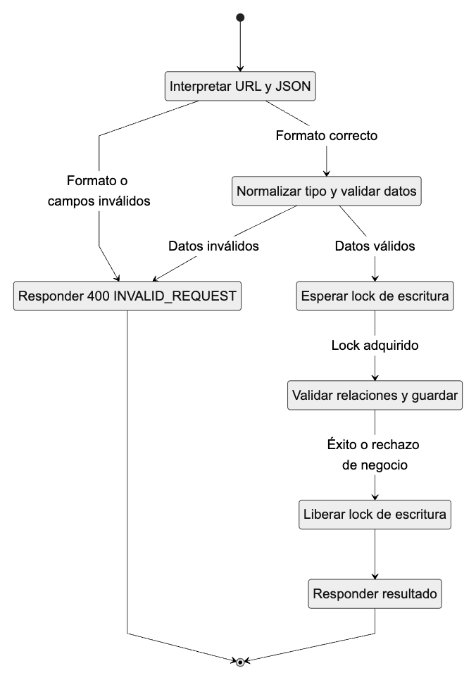

### Estados de creación y reemplazo bajo el lock

Los rechazos previstos se detectan antes de modificar los mapas. Un ID nuevo devuelve 201; cualquier reemplazo válido devuelve 200, sin comparar si los datos son idénticos. El lock no aporta rollback ante fallos inesperados, como se detalla en Concurrencia.

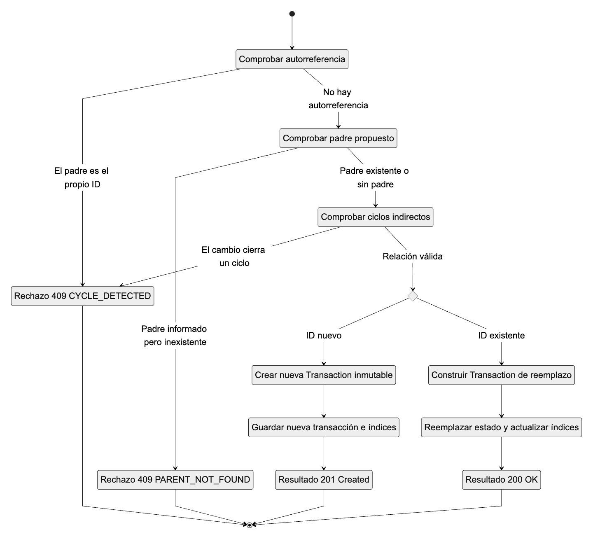

### Ciclo de vida de una transacción por ID

El ID de negocio se conserva al reemplazar el objeto inmutable. No existe borrado por API ni historial de versiones. El reinicio elimina los datos en memoria.

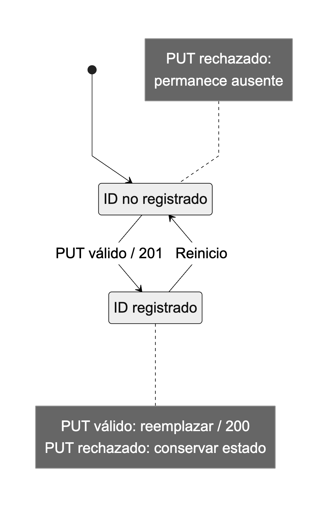

## Consultas y suma

| Tema | Decisión |
| --- | --- |
| Por tipo | Devolver solo IDs; sin coincidencias, `[]`. |
| Sin paginación | Devolver todos los IDs, sin orden garantizado. |
| Suma | Incluir el monto propio y todos los descendientes, de cualquier tipo. |
| Cálculo | Al consultar, sin totales precalculados. |
| Recorrido | Iterativo en profundidad: primero el nodo y luego sus hijos por ID ascendente. |
| Precisión | Acumular secuencialmente con `double`, sin redondeo adicional. |

Calcular al consultar simplifica las escrituras: no hay que recalcular totales de antecesores al cambiar monto o padre. Cada suma debe recorrer sus descendientes y mantiene ocupado el lock de lectura.

El bucle evita el límite de recursión, pero necesita guardar los IDs pendientes. El orden fijo hace reproducible la suma y agrega ordenamiento si los hijos no están ordenados. Conservamos `double` por contrato, con pérdida de precisión; `BigDecimal` sería una alternativa a evaluar en producción.

### Estados de búsqueda por tipo

La consulta normaliza el tipo y valida los parámetros. Bajo el lock de lectura obtiene una copia independiente del resultado completo o de la página. Sin coincidencias devuelve 200 con un array vacío. La respuesta JSON y el Link de continuación se construyen después de liberar el lock.

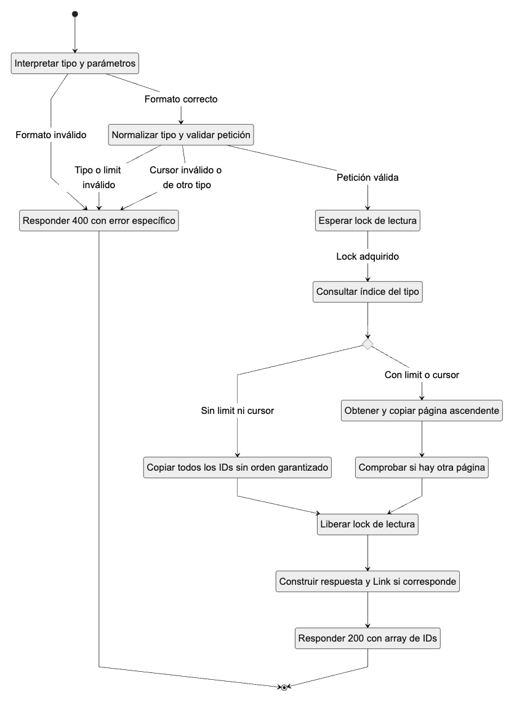

### Estados de selección de página

Las páginas se recorren por ID ascendente y continúan con IDs estrictamente mayores al cursor. Cada página es coherente, sin snapshot entre peticiones. La consulta sin parámetros mantiene el resultado completo sin orden garantizado; las reglas de limit y cursor se detallan en Paginación.

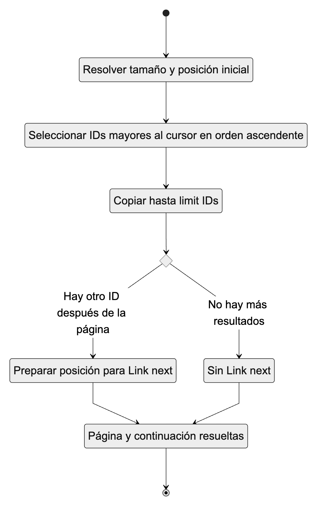

### Estados de consulta de suma

Un ID inválido devuelve 400; un ID válido inexistente devuelve 404. La búsqueda inicial y todo el recorrido mantienen el lock de lectura. Una acumulación finita devuelve 200 con sum; un desbordamiento devuelve 409 con SUM_OVERFLOW. Toda salida libera el lock antes de responder.

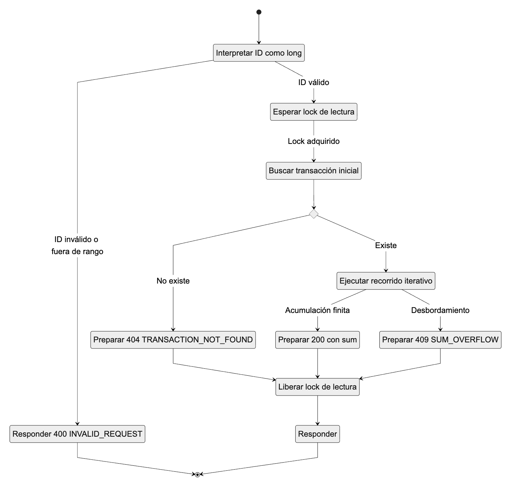

### Estados del recorrido iterativo

Una pila mantiene los IDs pendientes. Se suma primero el nodo y se apilan sus hijos por ID descendente para visitar sus ramas por ID ascendente. La acumulación double es secuencial y se detiene ante un desbordamiento, sin calcular otro total. Una transacción sin hijos devuelve su propio monto.

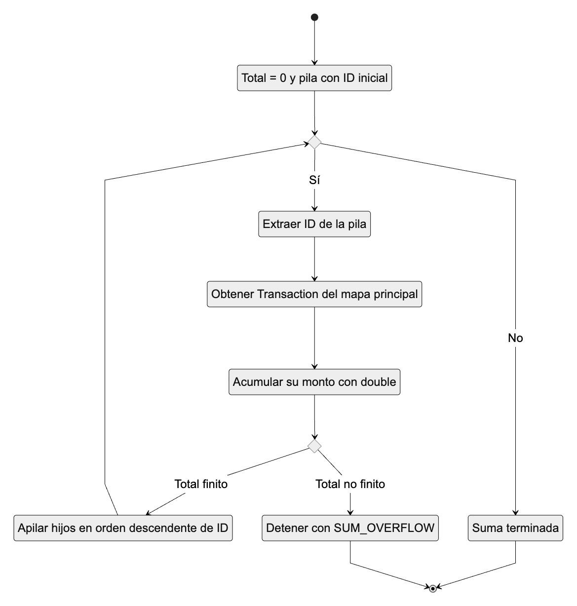

## Respuestas de error

| HTTP | Código y causa |
| --- | --- |
| `400` | `INVALID_REQUEST`: JSON, campos, valores o parámetros inválidos. |
| `400` | `INVALID_CURSOR`: token inválido o correspondiente a otro tipo. |
| `404` | `TRANSACTION_NOT_FOUND`: ID inexistente al consultar la suma. |
| `409` | `PARENT_NOT_FOUND`: padre inexistente. |
| `409` | `CYCLE_DETECTED`: ciclo o autorreferencia. |
| `409` | `SUM_OVERFLOW`: la acumulación excede el rango finito de `double`. |

Todos los errores usan `code` y un `message` específico **en inglés**:

```json
{
  "code": "PARENT_NOT_FOUND",
  "message": "Parent transaction with ID 10 does not exist."
}
```

Para desbordamiento: `"The transaction sum exceeds the finite double range."`.

Los códigos estables permiten al cliente distinguir causas sin interpretar el mensaje. Separar entrada inválida (`400`) de conflictos del estado (`409`) exige clasificar los errores; no se oculta un desbordamiento redondeando ni calculando otro total.

## Componentes

| Componente | Responsabilidad |
| --- | --- |
| Controller | Interpretar URL y JSON; devolver respuestas exitosas HTTP. |
| Servicio | Normalizar, validar reglas, calcular y coordinar el lock de la operación completa. |
| Almacenamiento | Mantener los tres mapas coherentes. |
| Exception handler | Traducir errores a HTTP y mensajes en inglés. |

Son componentes de una misma aplicación. No hay otra capa de handlers entre controller y servicio.

Separar HTTP, reglas y almacenamiento permite probar y cambiar cada responsabilidad. Agrega algunos archivos, pero evitamos una capa extra de handlers sin función propia. Otro servicio de negocio sería otra clase, no necesariamente otro servidor.

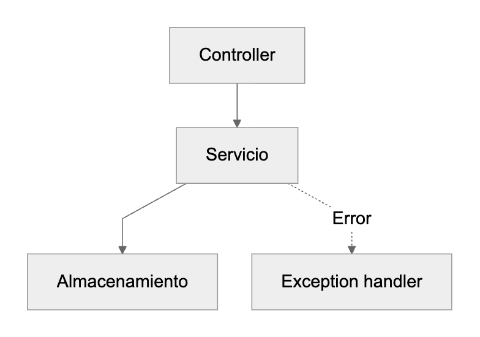

## Almacenamiento y encapsulación

Usamos **tres mapas en memoria**: uno guarda las transacciones y dos facilitan búsquedas. A estos últimos los llamamos mapas auxiliares; cumplen el papel de índices, pero no son índices de una base de datos.

| Tema | Decisión |
| --- | --- |
| Persistencia | Una instancia en memoria. Los datos se pierden al reiniciar. |
| `transactionsById` | Mapa principal: ID → objeto `Transaction` actual. |
| `idsByType` | Mapa auxiliar: tipo normalizado → conjunto ordenado de IDs. |
| `childIdsByParent` | Mapa auxiliar: padre → conjunto de IDs de hijos directos. |
| Objetos | `Transaction` inmutable. Un PUT crea otra instancia con el mismo ID. |
| Colecciones | Devolver copias independientes, obtenidas bajo el lock de lectura. |

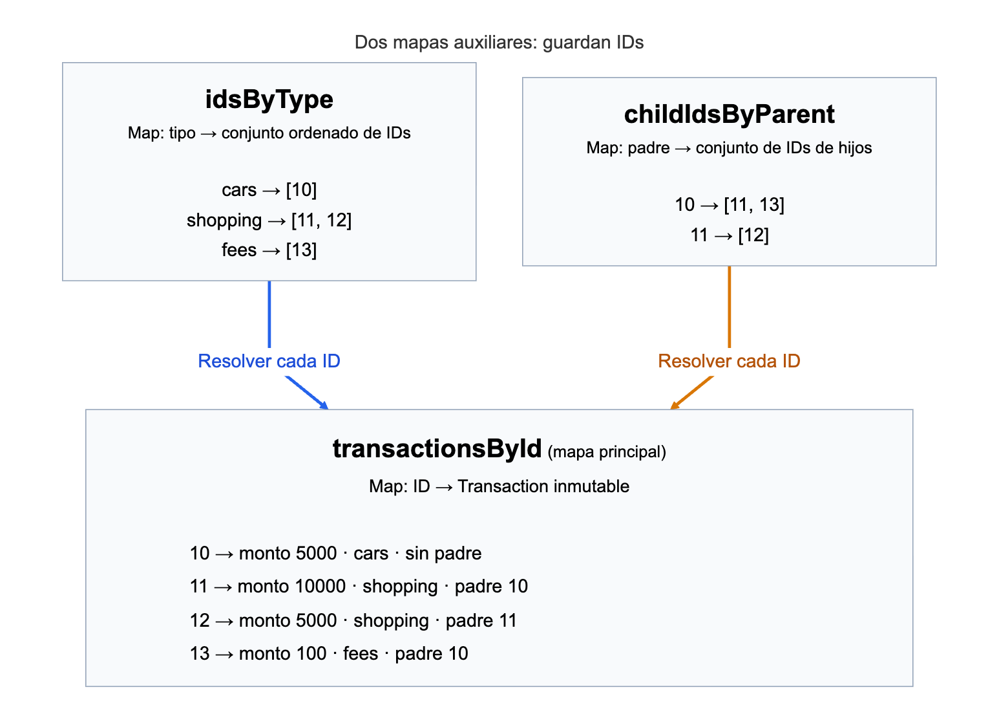

Con un solo mapa habría menos memoria y mantenimiento, pero habría que recorrer transacciones para buscar por tipo o encontrar hijos. Los dos mapas auxiliares evitan esos recorridos, a cambio de memoria extra y escrituras coordinadas.

Los mapas auxiliares guardan IDs para resolver el objeto actual en el mapa principal. Cambiar tipo o padre actualiza sus asociaciones; cambiar solo el monto reemplaza únicamente el objeto.

Las referencias directas no duplican objetos, pero podrían conservar el anterior tras un reemplazo:

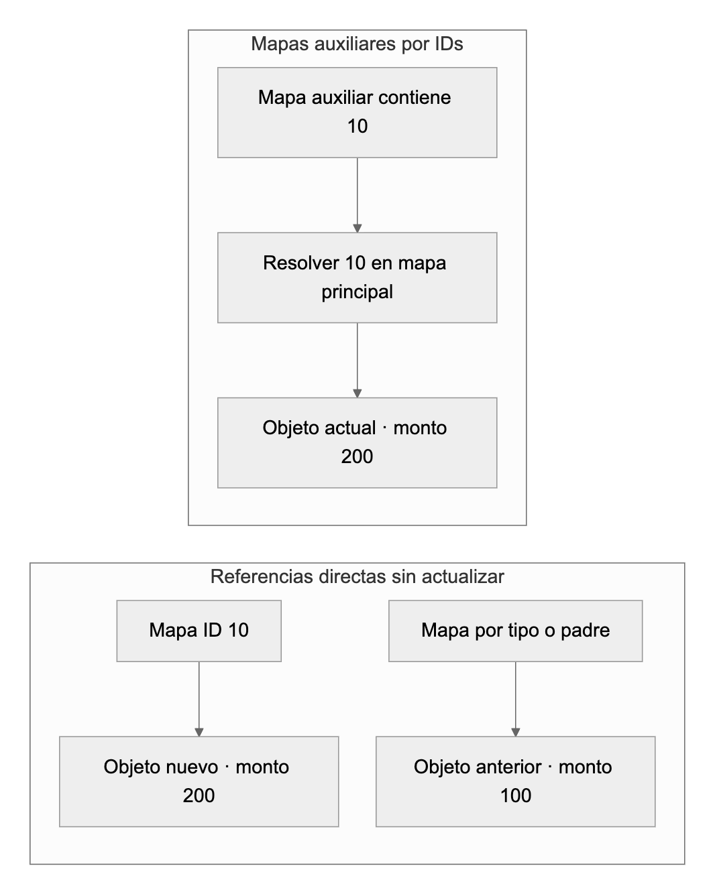

Guardar referencias directas permitiría acceder al objeto sin otra búsqueda, pero cada reemplazo inmutable exigiría actualizar esas referencias. Con IDs hacemos una búsqueda adicional, O(1) esperado con hashing, y mantenemos el estado actual en un solo lugar. No se presupone menor consumo de memoria.

La inmutabilidad evita cambios fuera del servicio, pero crea un objeto por reemplazo. Copiar colecciones también consume memoria y tiempo; evita modificaciones externas y cambios después de liberar el lock. Una vista de solo lectura de la colección interna no ofrece esa independencia.

## Concurrencia

| Tema | Decisión |
| --- | --- |
| Coordinación | Un lock de lectura/escritura compartido por todo el estado. |
| Lecturas | Pueden coexistir; mantener el lock durante toda la consulta. |
| Escrituras | Exclusivas desde la validación del estado hasta actualizar los tres mapas. |
| Orden | Sin orden de llegada garantizado entre requests concurrentes. |
| Updates simultáneos | Gana el último aplicado; sin control de versiones. |
| Límite | Una lectura larga demora escrituras. El lock no coordina varias instancias. |

Las validaciones independientes del estado pueden ejecutarse antes del lock. Proteger cada acceso al mapa por separado no alcanza para evitar ciclos concurrentes.

Un lock compartido simplifica la coherencia y permite varias lecturas, pero serializa todas las escrituras, incluso sobre IDs distintos. No usamos locks por transacción ni snapshots: sumar o cambiar relaciones abarcaría varios objetos y complicaría la coordinación. El último update aplicado puede sobrescribir otro válido; detectar ediciones antiguas requeriría control de versiones.

### Qué garantiza el lock

| Garantía | ¿La protege? |
| --- | --- |
| Prevalece el request recibido más tarde | No. Gana el último aplicado. |
| Las validaciones concurrentes no permiten crear ciclos | Sí, con validación y cambio bajo el mismo lock de escritura. |
| Los tres mapas describen el mismo estado al terminar una operación exitosa | Sí, si se completan sus cambios bajo el lock de escritura. |
| Una consulta no mezcla estados anteriores y posteriores | Sí, manteniendo el lock de lectura durante toda la consulta. |
| Recuperar el estado anterior ante un fallo inesperado durante la escritura | No. El lock no ofrece rollback. |

El SO puede pausar un thread sin liberarle el lock. Garantizamos operaciones completas sobre estados coherentes, no orden de llegada. El lock tampoco deshace cambios automáticamente si ocurre un fallo durante la escritura.

### Fallos inesperados

Un error o excepción inesperada durante la modificación de los mapas puede dejar cambios parciales; por ejemplo, un bug o falta de memoria después de actualizar el mapa principal. El lock evita interferencias entre requests, pero no restaura el estado anterior.

No contamos con un motor de base de datos transaccional ni implementamos rollback o recuperación propios en memoria. Aceptamos esta vulnerabilidad como limitación de la solución. El almacenamiento en memoria no impide construir esas garantías, pero hacerlo queda fuera del alcance. Reiniciar pierde todos los datos y no recupera el último estado válido.

Los rechazos previstos del negocio —datos inválidos, padre inexistente o ciclos— se validan antes de modificar el estado y no deben dejar cambios parciales.

### Casos que justifican la exclusión entre lecturas y escrituras

Ambos casos parten de este estado:

| ID | Monto | Padre |
| --- | --- | --- |
| 10 | 0 | Ninguno |
| 20 | 0 | Ninguno |
| 1 | 2 | 10 |

Un PUT reemplaza la transacción `1` con monto `3` y padre `20`. `sum(10)` vale **2 antes** y **0 después**. Devolver **3** significa mezclar estados.

#### Caso 1 — Lectura durante una escritura parcial

Sin coordinación, una lectura podría observar el mapa principal actualizado y el mapa de hijos todavía sin actualizar:

| Tiempo | Thread del PUT | Thread de `sum(10)` |
| --- | --- | --- |
| t0 | Reemplaza el objeto `1`: monto `3`, padre `20`. | |
| t1 | El SO lo pausa antes de actualizar los mapas auxiliares. | |
| t2 | | Consulta los hijos de `10`: todavía obtiene `[1]`. |
| t3 | | Lee el monto actual de `1`: `3`. |
| t4 | | Devuelve **3**, resultado incorrecto. |
| t5 | Actualiza los mapas auxiliares y termina. | |

**Con el lock:** el lector espera a que termine la escritura completa y devuelve **0**. Bloqueamos lecturas para no exponer cambios parciales.

#### Caso 2 — Escritura en medio de una lectura

Incluso una escritura completa puede invalidar los datos que una consulta ya había leído:

| Tiempo | Thread de `sum(10)` | Thread del PUT |
| --- | --- | --- |
| t0 | Consulta los hijos de `10`: obtiene `[1]`. | |
| t1 | El SO lo pausa. | |
| t2 | | Completa el cambio en los tres mapas: monto `3`, padre `20`. |
| t3 | Retoma el recorrido con el ID `1` obtenido antes. | |
| t4 | Busca su objeto actual y encuentra monto `3`. | |
| t5 | Devuelve **3**, resultado incorrecto. | |

**Con el lock:** la consulta conserva el estado anterior hasta terminar y devuelve **2**; después se aplica el PUT. Bloqueamos escrituras para mantener estable toda la lectura, no solo cada acceso individual.

No importa quién obtiene primero el lock: el lector observa el estado anterior o el posterior, nunca una mezcla.

## Paginación

| Tema | Decisión |
| --- | --- |
| Mecanismo | Cursor por ID ascendente; sin agregar otro identificador. |
| Cursor | Representa el último ID y el tipo normalizado. Continuar con IDs estrictamente mayores. |
| Respuesta | Array de IDs y header `Link` con `rel="next"` si quedan resultados. |
| Tamaño | `limit` entero entre 1 y 1000; valores inválidos devuelven `400`. |
| Consistencia | Cada página es coherente; no hay snapshot entre páginas. |

### Parámetros

| Petición | Resultado |
| --- | --- |
| Sin parámetros | Lista completa. |
| Solo `limit` | Primera página. |
| `limit` y `cursor` | Continuación. |
| Solo `cursor` | Continuación con tamaño 100. |

Se rechazan parámetros desconocidos o repetidos para evitar interpretar silenciosamente peticiones ambiguas. El parser tampoco convierte strings numéricos a números. La normalización usa `strip()` y `Locale.ROOT`, independiente del idioma de la máquina.

Ejemplo:

```http
GET /transactions/types/shopping?limit=2
Link: </transactions/types/shopping?limit=2&cursor=...>; rel="next"
```

Cuerpo: `[11,12]`. La siguiente página puede ser `[25,40]`.

### Continuidad y validación

| Caso | Comportamiento |
| --- | --- |
| Cursor inválido | `400 INVALID_CURSOR`: `The pagination cursor is invalid.` |
| Cursor de otro tipo | `400 INVALID_CURSOR`: `The pagination cursor does not match the requested transaction type.` |
| Último ID cambia de tipo | Continuar desde su posición, aunque ya no pertenezca al resultado. |
| Nuevo ID inferior al cursor | No aparecerá en las páginas siguientes. |
| Última página o lista vacía | No devolver enlace `next`. |

Bajo el lock de lectura se copia solo la página y se comprueba si existe otro ID. Después se libera el lock y se construye la respuesta. Usamos `TreeSet` para los IDs por tipo. El cursor codifica el último ID (`long`) y el tipo normalizado en UTF-8 mediante Base64 URL-safe; no cifra ni autentica datos.

El cursor permite continuar sin descartar posiciones como con offset, pero no facilita saltar a una página arbitraria. Ordenar los IDs al escribir permite recorrer páginas sin ordenar todo en cada consulta, a cambio de mantener ese orden.

El array y `Link` conservan el formato de respuesta; hacer la paginación opcional respeta la consulta completa original, aunque esa modalidad sigue pudiendo devolver listas grandes. Sin snapshot evitamos guardar sesiones o resultados completos; aceptamos que cambios entre páginas alteren lo que se observa. Otro ID incremental no resolvería esos cambios de tipo.

## Pruebas

El [plan de pruebas y controles de calidad](tests.md) detalla casos, niveles, concurrencia reproducible y herramientas propuestas de formato y lint.

Seguimos TDD en ciclos pequeños: test que falla por el motivo esperado, implementación mínima y refactorización con la suite en verde. Los tests se escriben antes del comportamiento que verifican y permanecen como regresión.

| Grupo | Verificación |
| --- | --- |
| Contrato | Ejemplos, normalización, códigos y mensajes en inglés. |
| Reemplazos | Cambios de monto, tipo y padre mantienen los tres mapas y las sumas. |
| Rechazos | No dejan cambios parciales. |
| Jerarquía | Ramas, cadenas profundas, autorreferencias y ciclos. |
| Concurrencia | Sin ciclos ni lecturas parciales; último update aplicado. |
| Encapsulación y paginación | Copias independientes, páginas, cursores y extremos de `long`. |

Las pruebas de integración verifican el contrato completo; las de reglas y concurrencia aíslan fallos difíciles de reproducir por HTTP. Se priorizan comportamientos y coordinación controlada, sin asumir un orden de llegada ni prometer rendimiento sin mediciones.

## Documentación y limitaciones

| Archivo | Contenido |
| --- | --- |
| `README.md` | Problema, entrega, comandos reales de aplicación, Docker y tests. Cerrar con limitaciones. |
| `docs/assigment.md` | Enunciado completo. |
| `docs/design-desicions.md` | Decisiones vigentes y sus motivos. |
| `docs/tests.md` | Casos de prueba, estrategia de ejecución y controles automáticos de calidad. |

Se conserva `double` por contrato, con precisión limitada y posible desbordamiento intermedio aunque el total matemático sea finito. La consulta completa sigue sin límite de tamaño. No se garantiza capacidad ilimitada, latencia ni preparación para producción. [Limitaciones completas](../README.md#limitaciones-y-compatibilidad-con-el-enunciado).

El enunciado, las decisiones y los comandos quedan separados para distinguir requisitos de elecciones propias. Las limitaciones explican qué mejoraríamos en producción sin alterar el contrato del challenge.

